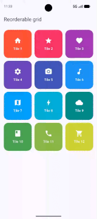

# flutter_reorderable_grid

A reorderable grid for Flutter with drag and drop, an iOS-style wiggle
animation and a customizable long-press context menu.



## Features

- **Drag and drop reordering** for any item type (`ReorderableGrid<T>`).
- **iOS-style wiggle**: the other items wiggle while you drag, and the effect
  fades in and out smoothly.
- **Long-press context menu** anchored to the item. Keep the finger down and
  move it to start dragging instead, or release it to keep using the menu.
- **Fully customizable menu**: size, colors, border, shadow, dividers, icon and
  font sizes, placement (auto, below or above the item), animation duration.
  Entries support icons, custom colors and a destructive style.
- **Polished feedback**: animated item movement, highlighted drop target,
  scaled drag preview, faded placeholder and haptic feedback.
- **Single-touch handling**: only one item can be pressed at a time, so
  multi-touch cannot start two drags at once.
- **You own the data**: the grid never modifies your list, it reports the new
  order through `onReorder`.
- **Reusable menu panel**: `ReorderableGridContextMenu` can also be used
  outside of the grid.

## Installation

```yaml
dependencies:
  flutter_reorderable_grid: ^0.0.1
```

This package uses the Material library from
[`material_ui`](https://pub.dev/packages/material_ui), so your app needs it
too:

```
flutter pub add material_ui
```

## Usage

```dart
import 'package:flutter_reorderable_grid/flutter_reorderable_grid.dart';
import 'package:material_ui/material_ui.dart';

ReorderableGrid<Tile>(
  items: tiles,
  itemKey: (tile) => tile.id,
  crossAxisCount: 3,
  onReorder: (reordered) => setState(() => tiles = reordered),
  itemBuilder: (context, tile, index) => TileCard(tile: tile),
)
```

`T` can be any class. Provide `itemKey` with a stable, unique id for each item.

**Important:** if `onReorder` does not update the list you pass in `items`, the
grid goes back to the previous order.

### Adding a context menu

```dart
ReorderableGrid<Tile>(
  // ...
  contextMenuBuilder: (tile) => [
    ReorderableGridContextMenuItem(
      icon: Icons.copy,
      label: 'Duplicate',
      onPressed: () => duplicate(tile),
    ),
    ReorderableGridContextMenuItem(
      icon: Icons.delete_outline,
      label: 'Delete',
      isDestructive: true,
      onPressed: () => remove(tile),
    ),
  ],
)
```

### Styling the menu

```dart
ReorderableGrid<Tile>(
  // ...
  contextMenuStyle: ReorderableGridContextMenuStyle(
    width: 220,
    itemHeight: 52,
    borderRadius: BorderRadius.circular(24),
    placement: ReorderableGridContextMenuPlacement.below,
    gap: -8, // negative values make the menu overlap the item
    showDividers: true,
  ),
)
```

A complete app is available in the [example](example/lib/main.dart).

## How the gesture works

1. **Long press** an item (500 ms).
2. Without `contextMenuBuilder` (or with an empty menu) the drag starts
   immediately.
3. With a menu, the menu opens first. Move the finger more than a few pixels to
   turn the gesture into a drag (the menu closes), or release it to keep the
   menu open. Tap anywhere else to close the menu.
4. Dropping the item in a new position calls `onReorder` with the new order.

## `ReorderableGrid` parameters

| Parameter | Description | Default |
| --- | --- | --- |
| `items` | The items to show, in order. | required |
| `itemBuilder` | Builds the widget of one item. Also used for the drag preview. | required |
| `onReorder` | Called with the new order after a drop. | required |
| `itemKey` | Stable key for each item. Strongly recommended. If omitted, the item itself is used as key (it needs a proper `==` and `hashCode`). | `null` |
| `contextMenuBuilder` | Menu entries for an item. If null or empty, a long press starts the drag. | `null` |
| `contextMenuStyle` | Look and placement of the menu. | `ReorderableGridContextMenuStyle()` |
| `crossAxisCount` | Number of columns. | `6` |
| `mainAxisSpacing` | Vertical space between rows. | `12` |
| `crossAxisSpacing` | Horizontal space between columns. | `12` |
| `childAspectRatio` | Width / height of each cell. | `1` |
| `padding` | Padding around the grid. | `EdgeInsets.zero` |

## `ReorderableGridContextMenuItem` parameters

| Parameter | Description | Default |
| --- | --- | --- |
| `icon` | Icon shown before the label. | required |
| `label` | Text of the entry. | required |
| `onPressed` | Called when tapped, after the menu has closed. | required |
| `isDestructive` | Uses the theme's error color (unless `color` is set). | `false` |
| `color` | Color of the text, splash and icon. | `onSurface` |
| `iconColor` | Color of the icon only. | same as text |

## `ReorderableGridContextMenuStyle` parameters

| Parameter | Description | Default |
| --- | --- | --- |
| `width` | Width of the panel. | `232` |
| `itemHeight` | Height of each entry. | `48` |
| `borderRadius` | Corner radius of the panel. | `16` |
| `padding` | Padding around the list of entries. | `vertical: 8` |
| `itemPadding` | Padding inside each entry. | `horizontal: 16` |
| `backgroundColor` | Panel color. | theme surface |
| `borderColor` | Border color. | translucent `onSurface` |
| `borderWidth` | Border width (0 hides it). | `1` |
| `elevation` | Panel elevation. | `10` |
| `shadowColor` | Shadow color. | translucent black |
| `showDividers` | Draw dividers between entries. | `true` |
| `dividerColor` | Color of the dividers. | translucent `onSurface` |
| `iconSize` | Size of the icons. | `20` |
| `iconSpacing` | Space between icon and label. | `12` |
| `fontSize` | Size of the labels. | `15` |
| `fontWeight` | Weight of the labels. | `FontWeight.w500` |
| `gap` | Distance between item and menu (negative to overlap). | `4` |
| `screenMargin` | Minimum distance from the screen edges. | `12` |
| `placement` | `auto`, `below` or `above` the item. | `auto` |
| `animationDuration` | Duration of the appearance animation. | `140 ms` |

## Limitations

- All items are built at once (no lazy building). It is meant for dozens of
  items, not thousands.
- The grid has its own scroll view and does not auto-scroll while you drag
  near the edge of the screen.
- The number of columns is fixed (`crossAxisCount`), not responsive.
- The long-press delay (500 ms) is not configurable yet.
- The menu and theming rely on the Material library (`Theme`, `Material`,
  `InkWell`).

## Issues and feedback

Found a bug or have an idea? Please open an issue on
[GitHub](https://github.com/ornellix/FlutterReorderableGrid/issues).

## License

MIT, see [LICENSE](LICENSE).